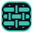

## The name

Hyperledger Fabric is named after cloth. Cloth is woven from two sets of threads: the **warp**, stretched along the loom and held fixed, and the **weft**, passed across the warp, over and under, one row at a time.

The name came from the second set. In a Fabric network the organisations, peers and channels are set up once and stay in place, like the warp. Identities and transactions are what pass through them, like the weft, and a wallet is where they start.

The mark draws three weft threads passing over and under two warp threads.

## Writing it

Weft is written lowercase in the wordmark (`weft`) and capitalised in running text ("Weft").

When referring to Fabric, use the tagline: **weft, an identity wallet for Hyperledger Fabric**. Keep "Hyperledger" and "Fabric" out of the name and logo; they're Linux Foundation trademarks.

## Mark

Three weft threads pass over and under two warp threads. At 32px and below the gaps would fall under a pixel, so a second drawing takes over: a 2×2 weave fitted to the 16px pixel grid. It keeps the over-and-under idea and stays sharp in toolbars and browser tabs.

| | File |
|---|---|
|  | `packages/brand/logo/mark.svg`: default |
| | `mark-inverted.svg`: on teal or light backgrounds |
| | `mark-small.svg`: 32px and below |
| | `lockup-dark.svg`, `lockup-light.svg`: mark plus wordmark |

## Product marks

The Weft site, Weft Wallet and these docs use the main mark. Three products have their own, drawn in the same threads. The playground and the main mark sit on a teal tile: they're for people passing something through the network. Weft Network and Weft Explorer sit on ink inside a teal frame, the loom, because an organisation runs them for itself.

| | Product | Drawing |
|---|---|---|
|  | Weft Playground | The cloth with a pick still to pass |
|  | Weft Network | The warp alone: the organisations, held fixed |
|  | Weft Explorer | The finished cloth: one organisation's record |

The files and their construction rules are in `packages/brand` (`logo/products/` and `SYSTEM.md`).

## Colour

| Swatch | Name | Hex | Use |
|---|---|---|---|
|  | Ink | `#0B1218` | Background |
|  | Slate | `#17212B` | Cards |
|  | Thread | `#3FC1B0` | The only brand accent |
|  | Amber | `#E8A33D` | Warnings and ledger writes only |
|  | Signal | `#E5675B` | Failures only |
|  | Linen | `#F5F3EE` | Light backgrounds |

Amber and Signal carry meaning. Don't use them for decoration, or people stop noticing them.

## Type

- Atkinson Hyperlegible Next: interface text and explanations.
- Atkinson Hyperlegible Mono: anything a user might copy or compare (MSP IDs, enrolment IDs, transaction IDs, fingerprints, function names, arguments) and the wordmark.

Both come from the Braille Institute and are drawn so that characters people confuse, such as 0 and O or 1, l and I, differ in shape. Weft shows you exactly what you sign; the type is chosen for the same reason.

Tokens for both, plus spacing and radii, are in `packages/brand/tokens.css` and `tokens.json`.
